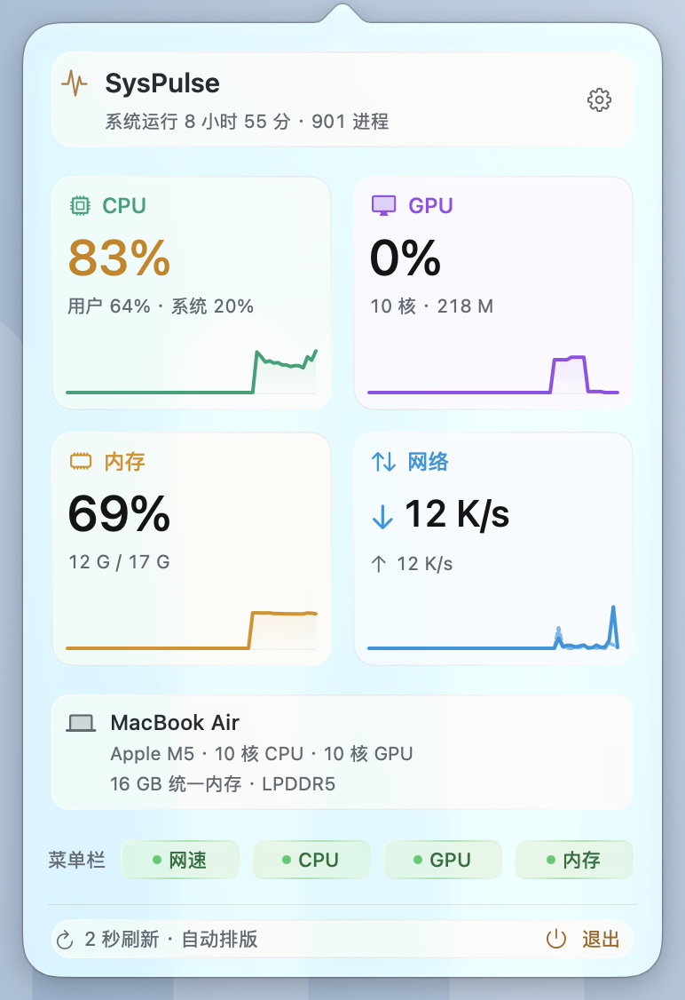
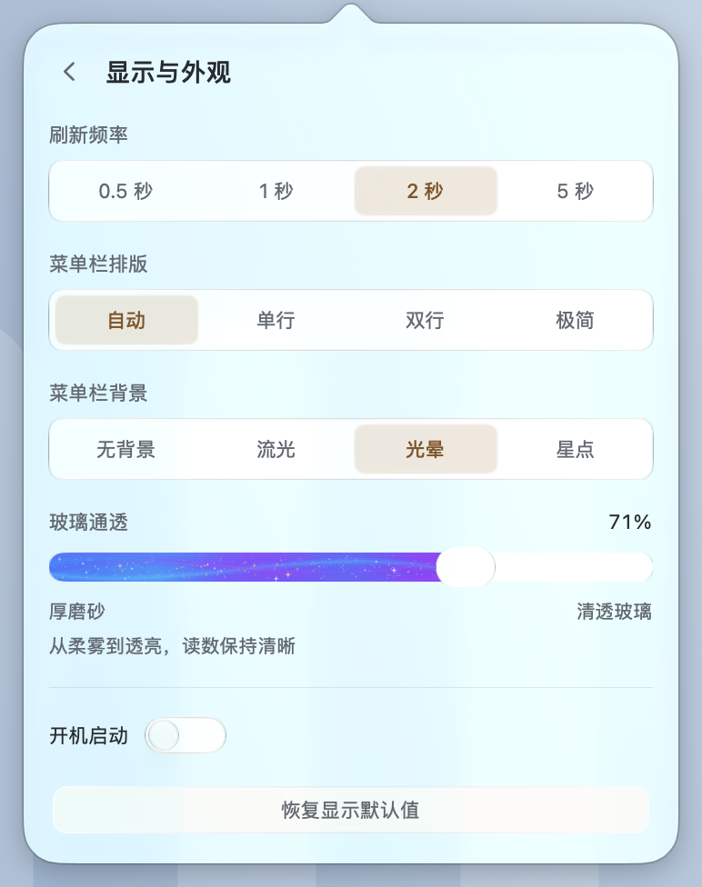
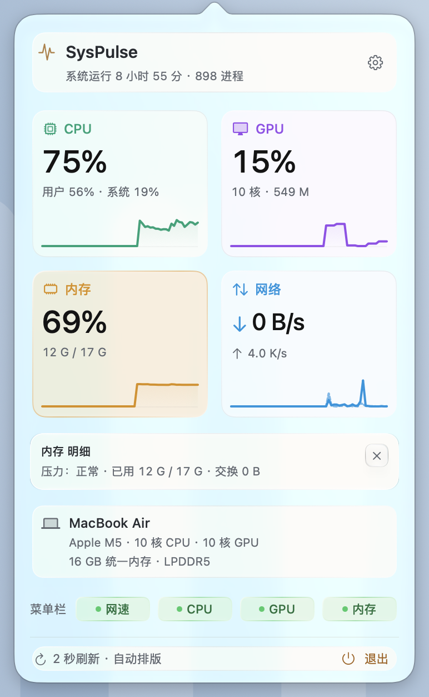
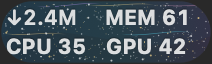
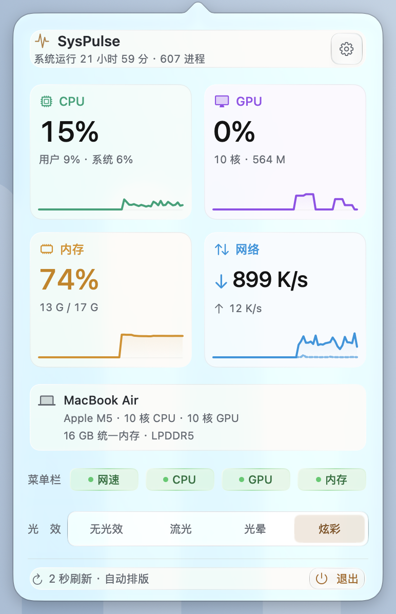

# SysPulse

**macOS 菜单栏实时系统监控**：网速、CPU、GPU、内存，菜单栏看读数，点击查看曲线和详情。

原生 Swift + SwiftUI，无第三方依赖、无网络请求、不收集数据。常驻菜单栏，不占程序坞。

<p align="center">
  
  
</p>

左图为 **第一页 · 指标面板**，右图为 **第二页 · 显示与外观**。两张均为 v1.5.0 源码运行后的原生窗口截图，使用隔离偏好、实时采样与受控背景拍摄；已显示新版标题布局、移入第二页的菜单栏背景选择，以及新版通透滑条。读数、设备信息和玻璃透出的背景随机器与时间变化。

**v1.5.1（2026-10-12）**：优化星点背景的位图生成、粒子缓存与图层更新，本机常态 CPU 从约 20% 降到约 4%；恢复鼠标悬停时跟随位置的偏转与反光，移出后平滑复位。保留星点外观、10 fps 和既有设置，面板布局沿用 v1.5.0，以上两页图片继续适用。详见 [更新记录](<CHANGELOG.md>) 与 [本版更新报告](<docs/UPDATE-v1.5.1.md>)。星点预览见下方 [菜单栏](#菜单栏)。

## 下载与安装

**[下载 SysPulse-1.5.1.dmg](https://github.com/orange-ora/SysPulse/releases/download/v1.5.1/SysPulse-1.5.1.dmg)** · [所有版本](https://github.com/orange-ora/SysPulse/releases) · [SHA-256 校验文件](https://github.com/orange-ora/SysPulse/releases/download/v1.5.1/SysPulse-1.5.1.dmg.sha256)

支持 **macOS 14.0+、Apple Silicon 和 Intel**，安装包包含 `arm64` 与 `x86_64` 两种架构，正常运行不需要 Rosetta。

1. 打开 DMG，将 **SysPulse** 拖入 **Applications**。升级时选择“替换”，继续使用 `/Applications/SysPulse.app`。
2. 首次启动，在“应用程序”中右键 **SysPulse → 打开**。若仍被拦截，在“系统设置 → 隐私与安全性”中选择“仍要打开”。
3. 菜单栏出现读数后，推出 **SysPulse 安装盘**。

应用使用 **ad-hoc 签名，未做 Apple 公证**；首次打开可能需要上述系统确认。发布包会校验签名完整性，并附 SHA-256 文件。

没有程序坞图标和 ⌘Tab 条目是菜单栏工具的正常行为。退出请点菜单栏图标，再点面板右下角“退出”。

## 指标面板

- **CPU**：总占用、用户 / 系统占比、核心数和历史曲线。
- **GPU**：驱动提供的利用率、核心数、GPU 内存与曲线；92% 起黄警、97% 起红警，未就绪与机型未提供计数器分别显示。
- **内存**：占用比例、已用 / 总容量、系统内存压力、交换分区与曲线；数字颜色按压力状态告警，与占用比例独立。
- **网络**：下行 / 上行速度、实线 / 虚线双曲线和本次运行累计流量。
- **点击卡片展开详情**：详情、下方内容与窗口同步展开或收起，上沿固定；支持中途反向与快速切换指标。鼠标离开对应卡片和详情后，空闲约 10 秒自动收起；停留或移入时保持展开。
- **设备信息**：自动读取当前 Mac 的机型、处理器、CPU / GPU 核心数和物理内存。Apple Silicon 显示统一内存；Intel 在系统提供 DIMM 字段时显示容量与类型组合，不推测未公开的插槽。
- **反光悬浮**：卡片和控件的反光与边缘亮线跟随鼠标，前景与玻璃共同响应，点击范围和布局保持固定。设置、退出和返回按钮默认无框，悬停时显露玻璃轮廓。
- **机器信息彩蛋**：连续点击机器信息栏六下，小电脑轻跳并出现星星和“今天也在努力运行 ✦”；短暂显示后恢复真实信息，不改动指标或设置。

<p align="center">
  
</p>

详情示例同样使用本次拍摄的 v1.5.0 原生截图，展示新版布局下的内存明细。

曲线保留 **60 个采样点**，跨度随刷新周期变化；默认 2 秒刷新时约为 2 分钟。百分比曲线使用固定 0–100% 量程，网络曲线按当前量级显示。

面板打开时延迟加载隐藏详情，关闭时只收束外层窗口，内部正文保持自然尺寸。本机再次打开的同步准备从约 65–73 ms 降至 53–61 ms；首次打开仍有约 200 ms 初始化开销，测量方法及边界见 [v1.5.0 响应说明](<docs/UPDATE-v1.5.0.md#打开面板的响应>)。

## 显示与外观

右上角齿轮进入独立设置页，可连续调整选项，面板保持打开。

| 选项 | 可选范围 | 新安装 / 恢复默认值 |
| --- | --- | --- |
| 刷新频率 | 0.5 / 1 / 2 / 5 秒 | 2 秒 |
| 菜单栏排版 | 自动 / 单行 / 双行 / 极简 | 自动 |
| 菜单栏背景 | 无背景 / 流光 / 光晕 / 星点 | 光晕 |
| 玻璃通透 | 0–100%，厚磨砂到清透玻璃 | 71% |
| 菜单栏指标 | 网速 / CPU / GPU / 内存独立开关 | 全部开启 |

已有有效设置在升级后保留，原炫彩选择更新为星点。“恢复显示默认值”只恢复显示与外观选项，**不改变开机启动**；首次启动也不会自动注册登录项。开机启动由设置页的系统开关控制。

macOS 26+ 使用原生 **Liquid Glass**；macOS 14 / 15 使用 `NSVisualEffectView` 磨砂回退。通透度只调节面板背景材质，读数与曲线保持清晰。面板采用浅色外观，菜单栏读数随系统外观变化。

“玻璃通透”使用透明玻璃轨道，已选区为蓝紫与青色交织的金白星点；滑钮保持无色玻璃。星点各自游走与回转，拖动时平滑提速并短暂增多，滑钮随按压形变、拖动方向牵引，松手后回弹；滑钮与轨道挖空区域同步，方向键按 1% 调节。

系统开启“减少透明度”时，面板使用实色背景并停用通透滑块。开启“减少动态效果”时星点静止，取消位移、缩放、旋转和滑钮形变。显示项使用独立绿色开关；四种背景共用一条分段选择底板。

## 菜单栏

自动排版根据空间在三种密度之间切换；也可在设置页固定选择。

原有菜单栏图片在面板关闭时实拍，展示三种排版；数值会随采样变化。

| 排版 | 显示方式 | 实际截图 |
| --- | --- | --- |
| 单行 | 网速、CPU、GPU、MEM 标签与读数在同一行 |  |
| 双行 | 网速与内存 / CPU 与 GPU 分两行，保留标签 |  |
| 极简 | 下行速度与三个不带标签的百分比，双行显示 |  |

- 各数值槽按最宽可能值预留空间，读数变化时避免宽度跳动。
- 悬停显示完整指标，包括网络上行速度；所有指标关闭时显示脉搏占位图标。
- CPU 占用达到 80% 变橙、92% 变红。**GPU 利用率达到 92% 变黄、97% 变红**，低于 92% 保持正常文字色。内存数字按系统压力着色：正常保持原文字色，警告变橙，严重变红；未知使用中性色并在提示中标明。星点模式也保留这些告警颜色。

| 背景 | 外观 | 图片 |
| --- | --- | --- |
| 无背景 | 普通读数，无持续背景重绘 |  |
| 流光 | 缓慢横移的三色光带 |  |
| 光晕 | 多个彩色光斑独立游走，兼容旧“漫散射”存值 |  |
| 星点 | 通透水蓝与淡紫玻璃，金白微星独立散动，金丝和彩丝轻作挑染 |  |

无背景、流光与光晕保留原有实拍图；v1.5.0 加强了流光与光晕配色。星点图为受控底色上的生产渲染预览，**不是原生菜单栏截图**，实际玻璃透色随桌面背景和系统外观变化。

<p align="center">
  
</p>

<details>
<summary>旧版炫彩外观（v1.4.x）</summary>

原有炫彩菜单栏与面板截图保留在这里，供查看旧版设计。v1.5.0 已将该背景更新为星点，取消字面扫光并恢复普通指标配色。


<p align="center">
  
</p>

</details>

背景动画沿用 10 fps 共用时钟；显示器休眠、锁屏或屏保时自动挂起。星点与细丝避开文字区域，水色保持稳定，不做字面扫光；v1.5.1 恢复鼠标悬停的反光与偏转，移出后平滑复位。星点每帧只生成一次背景位图并更新独立图层，面板开合期间继续运动，文字复用缓存；减少动态效果时复用静止帧并取消偏转。

## 数据来源与兼容性

| 指标 | 系统接口 |
| --- | --- |
| CPU | `host_processor_info(PROCESSOR_CPU_LOAD_INFO)`，逐核 tick 差分 |
| GPU | IOKit `IOAccelerator` 的 `PerformanceStatistics` |
| 内存 / 交换分区 | `host_statistics64(HOST_VM_INFO64)` / `sysctl vm.swapusage` |
| 内存压力 | `sysctl kern.memorystatus_vm_pressure_level`，读取系统正常 / 警告 / 严重三态 |
| 网络 | `sysctl(NET_RT_IFLIST2)`，按物理 `en*` 接口计算字节增量 |
| 运行时长 / 进程数 | `systemUptime` / `sysctl KERN_PROC_ALL` |
| 设备信息 | sysctl 回退 + 启动时一次后台 `system_profiler` 查询 |

网速使用十进制单位（`M = 1000²`），统计物理网卡总流量，排除回环、VPN 等虚拟接口以避免重复计数，不按进程拆分。累计流量表示本次应用运行期间可信采样的总量。

GPU 利用率和核心数依赖驱动，部分 Intel 或其他机型可能不提供。缺值会显示等待或不可用，后续有效数据可恢复。Apple Silicon 上的 GPU 内存属于统一内存，不能理解为独立显存。

内存压力读取系统三态，不把占用率或交换容量换算为压力，也不重现活动监视器的压力曲线。该 sysctl 选择器不是 Apple 承诺稳定的公开接口；每轮采样检查读取结果与四字节长度，不支持、读取失败或未知值时明确显示“未知”，不沿用旧告警。

实际运行检查环境为 **Apple M5 / macOS 27.2**；Intel 与 macOS 14 / 15 尚无实机运行验收。面板延迟结果来自本机受控测量，不代表不同机器上的性能保证。

## 命令行

应用默认不在 `PATH`，请使用完整可执行路径：

```bash
APP=/Applications/SysPulse.app/Contents/MacOS/SysPulse
"$APP" --dump                  # 指标自检
"$APP" --enable-login-item     # 开启开机启动
"$APP" --disable-login-item    # 关闭开机启动
"$APP" --login-item-status     # 查询登录项
```

## 从源码构建

运行要求 macOS 14.0+；构建需要带 **macOS 26 或更新 SDK** 的 Xcode / 命令行工具，Swift 语言模式为 5。

```bash
git clone https://github.com/orange-ora/SysPulse.git
cd SysPulse
./build.sh                    # 双架构编译、验证、备份、安装并重启
./build.sh --local            # 只生成 dist/SysPulse.app.zip
./build.sh --no-launch        # 安装后不启动
```

正式安装固定在 `/Applications/SysPulse.app`；临时展开包放在不参与索引的目录中，构建结束后清理，回滚备份仅保留压缩归档。`Package.swift` 可用于 IDE 和 SwiftPM，正式打包以 `build.sh` 为准。

发布由版本标签触发，使用 macOS 26 SDK、警告按错误处理的 `arm64` / `x86_64` 构建，校验版本、签名与 DMG，并发布校验文件。

## 已有验证与开发工具

v1.5.1 发布前执行最终回归，包含 **609 项生产断言、60 项控制器与玻璃检查、39 项开合与反向检查、734 项原生检查、71 项受控打包检查**；另完成 10 个初始原生渲染状态与 1 项设置交互汇总检查。完整结果、性能测量与兼容边界见 [本版更新报告](<docs/UPDATE-v1.5.1.md>)。历史版本的验证范围见 [更新记录](<CHANGELOG.md>)。

开发者可执行以下工具重现相应回归：

```bash
bash Tools/Regression/run.sh
python3 Tools/Regression/BuildPackagingTests.py
bash Tools/PanelProbe/run.sh   # 隔离偏好和登录项的原生界面验证
```

## 卸载

先在设置页关闭“开机启动”，再退出应用并删除 `/Applications/SysPulse.app`。命令行方式：

```bash
/Applications/SysPulse.app/Contents/MacOS/SysPulse --disable-login-item
pkill -x SysPulse
rm -rf /Applications/SysPulse.app
rm -f ~/Library/Preferences/com.local.syspulse.plist
```

## 许可

MIT License，详见 [LICENSE](<LICENSE>)。
